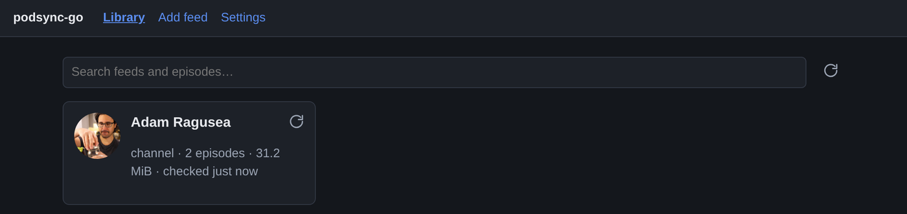
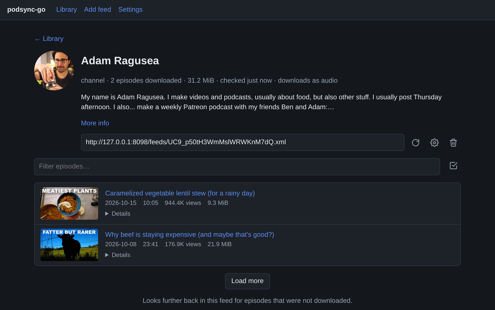
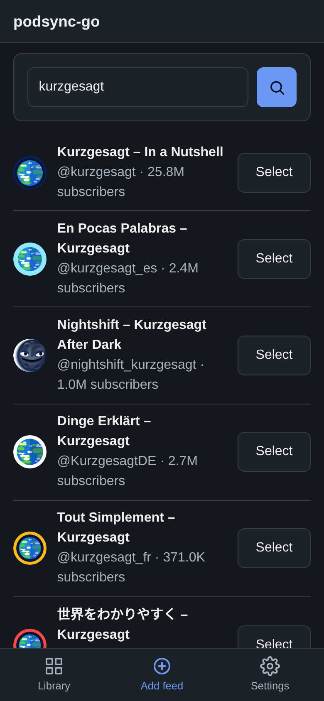
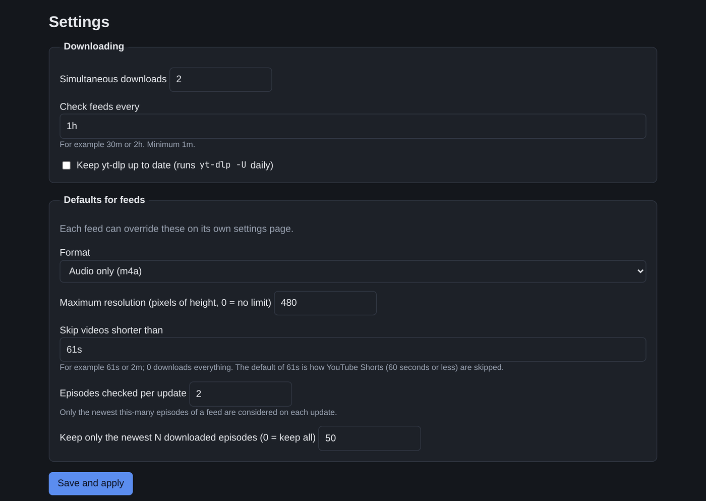

# podsync-go

Turn YouTube channels and playlists into podcast feeds.

Manage your library, edit settings, and add new feeds straight from the built-in web UI.

- Add feeds with one box: paste a channel or playlist link, type an `@handle`, or search YouTube channels by name
- Per-feed options: audio or video, max resolution, minimum video length, etc.
- Episode filtering using title include/exclude regex
- Episode cleanup (keep last X)
- OPML export
- Plain-file storage: no database; uses media sidecar data and one `config.toml`
- Automatic yt-dlp self update.
- mp3 encoding

Inspired by [mxpv/podsync](https://github.com/mxpv/podsync)

## Web UI

**Library** — every feed you're subscribed to, with its episode count, size on disk and last check:



**Feed** — one channel or playlist's episodes, with Load More to look further back than the newest page:



**Add a feed** — search channels by name, or paste a link/`@handle`/playlist URL directly:



**Settings** — concurrency, check interval and the per-feed defaults (each feed can override any of them):



## Quick start (Docker)

1. Get the code, create the folders and copy the example compose file:

   ```sh
   git clone <this repository> podsync-go && cd podsync-go
   mkdir -p config data
   cp compose.example.yaml compose.yaml
   ```

   `config/` and `data/` don't strictly need to exist first — the container starts as root
   and its entrypoint chowns them to `PUID`/`PGID` (default `1000:1000`, set in
   `compose.yaml`) before running podsync, fixing them up even if Docker auto-created them
   as root:root. Pre-creating them is just for predictability.

   The example builds one image from the repository. To build it yourself for both architectures:

   ```sh
   docker buildx build --platform linux/amd64,linux/arm64 -t podsync .
   ```

2. **Edit `compose.yaml`**: set `PODSYNC_BASE_URL`, `PODSYNC_USERNAME`, and `PODSYNC_PASSWORD`.

If you plan on maintaining config.toml by hand, you can set `PODSYNC_WEBUI_DISABLED=true` to turn the web UI off entirely (then `PODSYNC_USERNAME`/`PODSYNC_PASSWORD` are not needed).

3. Start it:

   ```sh
   docker compose up -d
   ```

## Configuration

The feed settings live in one TOML file (default `config.toml` in the working directory, `/config/config.toml` in Docker; override with the `PODSYNC_CONFIG` environment variable). If it doesn't exist it is created with defaults. See [`config.example.toml`](config.example.toml) for a fully commented example.

| Section / key                | Default | Meaning                                                                                                                                                             |
| ---------------------------- | ------- | ------------------------------------------------------------------------------------------------------------------------------------------------------------------- |
| `download.concurrency`       | `2`     | Simultaneous downloads (1-16)                                                                                                                                       |
| `download.update_interval`   | `30m`   | How often feeds are checked (minimum `1m`)                                                                                                                          |
| `download.self_update`       | `false` | Run `yt-dlp -U` at startup and daily                                                                                                                                |
| `defaults.format`            | `audio` | `audio` or `video`                                                                                                                                                  |
| `defaults.max_video_height`  | `720`   | Max video height in pixels; `0` = no limit; only applies when `format = "video"`                                                                                    |
| `defaults.audio_quality`     | `high`  | `high` or `low`; only applies when `format = "audio"`                                                                                                               |
| `defaults.min_duration`      | `"61s"` | Skip videos shorter than this; the default skips YouTube Shorts (60 seconds or less). `"0s"` downloads everything. Videos whose length is unknown are never skipped |
| `defaults.page_size`         | `10`    | Newest N episodes considered per update                                                                                                                             |
| `defaults.cleanup_keep_last` | `50`    | Keep newest N downloaded episodes; `0` = all                                                                                                                        |
| `[[feeds]]`                  |         | One block per feed: `id`, `kind` (`channel` or `playlist`), `name`, plus optional overrides of any `defaults` key                                                   |
| `feeds.title_include`        | empty   | Per feed only: regex; if set, only matching titles are downloaded                                                                                                   |
| `feeds.title_exclude`        | empty   | Per feed only: regex; matching titles are skipped, e.g. `(?i)sponsored\|#shorts`                                                                                    |
| `feeds.opml_exclude`         | `false` | Per feed only: leave this feed out of the `/opml.xml` export                                                                                                        |

`config.toml` is all you need to recreate your list of feeds on a new machine: start with an empty data directory and the feeds are fetched again.

### Deployment settings

Everything below is set once per deployment and needs a restart to change; none of it is in `config.toml` or editable in the web UI. Almost all of it is an environment variable only. podsync fails to start with a message naming whatever's missing or invalid, rather than falling back to a guess.

| Environment                     | Default            | Meaning                                                                                                                                                                                                                                                                                                                                  |
| ------------------------------- | ------------------ | ---------------------------------------------------------------------------------------------------------------------------------------------------------------------------------------------------------------------------------------------------------------------------------------------------------------------------------------- |
| `PODSYNC_CONFIG`                | `config.toml`      | The TOML file holding feeds and defaults                                                                                                                                                                                                                                                                                                 |
| `PODSYNC_LISTEN_ADDR`           | `:8080`            | Where podsync serves feeds, media and (unless disabled) the web UI — one listener for all of it                                                                                                                                                                                                                                          |
| `PODSYNC_BASE_URL`              | **required**       | Public address of `PODSYNC_LISTEN_ADDR` as podcast apps and your browser reach it; used in feed links, enclosure URLs and to load thumbnails. There is no default — podsync refuses to start without it, since a wrong guess would silently break feed links                                                                             |
| `PODSYNC_YOUTUBE_API_KEY`       | **required**       | A YouTube Data API v3 key. Feeds are listed and links resolved through the official API (downloads and channel name search still use yt-dlp). See [YouTube API key](#youtube-api-key) below                                                                                                                                             |
| `PODSYNC_DATA_DIR`              | `./data`           | Where media and metadata are stored (`/data` in the Docker image)                                                                                                                                                                                                                                                                        |
| `PODSYNC_YTDLP_PATH`            | `yt-dlp` on `PATH` | Run a yt-dlp other than the one on `PATH` — a bare name resolved on `PATH` or an absolute/relative path. If you set this, it's checked at startup with the same logic as running it (podsync refuses to start if it doesn't resolve); leave it unset and a missing default `yt-dlp` is just a status-banner issue, not a startup failure |
| `PODSYNC_MP3_ENCODING_DISABLED` | `false`            | Audio downloads (`format = "audio"`) are re-encoded to mp3 by default; set this to turn that off and keep the original m4a                                                                                                                                                                                                               |
| `PODSYNC_WEBUI_DISABLED`        | `false`            | Serve only feeds and media; don't serve the management web UI at all                                                                                                                                                                                                                                                                     |
| `PODSYNC_USERNAME`              | empty              | Username for the web UI's login page. Required unless `PODSYNC_WEBUI_DISABLED`                                                                                                                                                                                                                                                           |
| `PODSYNC_PASSWORD`              | empty              | Password for the web UI's login page. Required unless `PODSYNC_WEBUI_DISABLED`                                                                                                                                                                                                                                                           |
| `PODSYNC_TLS_CERT_FILE`         | empty              | Certificate file; when set (together with `PODSYNC_TLS_KEY_FILE`), the one listener speaks HTTPS instead of HTTP. Checked at startup: podsync refuses to start if either file is missing or only one of the pair is set                                                                                                                  |
| `PODSYNC_TLS_KEY_FILE`          | empty              | Private key file matching `PODSYNC_TLS_CERT_FILE`                                                                                                                                                                                                                                                                                        |

### YouTube API key

podsync lists feeds through the YouTube Data API v3, so it needs a key:

1. In the [Google Cloud console](https://console.cloud.google.com/), create a project (or pick one).
2. Enable **YouTube Data API v3** for it (_APIs & Services → Library_).
3. Create an **API key** (_APIs & Services → Credentials_). Restricting it to the YouTube Data API v3 is a good idea.
4. Set it as `PODSYNC_YOUTUBE_API_KEY` and restart.

The free quota is 10,000 units a day. Checking a feed costs about 2 units per 50 episodes checked (one call for the list, one for durations and live status), so a 30-minute interval uses roughly 100 units per feed per day: about 100 feeds before you run out. A playlist sorted descending costs more, because it is read to its end on every check (1 unit per 50 episodes in it). Adding a feed by link or `@handle` costs 1–2 units. Name search doesn't use the API at all. When the quota runs out, the banner says so and listing resumes after midnight Pacific time; downloads already queued are unaffected.

## Troubleshooting

Check the banner at the top of the page first; it quotes yt-dlp's error.

- **"Sign in to confirm you're not a bot"**: YouTube wants a logged-in session. Export cookies from a browser where you're signed in to a `cookies.txt` file (Netscape format) and upload it under _YouTube cookies_ in Settings; no restart needed. It's stored as `cookies.txt` next to `config.toml`. Use a throwaway account if you can; the cookies grant access to that account. (`PODSYNC_COOKIES_FILE` is no longer used.)
- **Members-only videos**: videos only a channel's paying members can watch are skipped, shown greyed out with a _members only_ label, and never retried on their own. If you're a member, upload that account's cookies in Settings; the page then asks which channels' members-only videos to try again.
- **"Unable to extract..." / downloads suddenly fail everywhere**: yt-dlp is out of date. Tick _Keep yt-dlp up to date_ in Settings, or pull a newer image / update the binary. (Self-update only works if the yt-dlp binary is writable by the app, as in the Docker image. It cannot update a yt-dlp installed by a package manager.)
- **HTTP 429 / rate limited**: YouTube is throttling you. It retries on the next update; lower _Simultaneous downloads_ and raise _Check feeds every_ if it keeps happening.
- **"Invalid username or password" on the login page**: check `PODSYNC_USERNAME`/`PODSYNC_PASSWORD` in `compose.yaml` match what you're typing. Feed and media URLs never need a login, so podcast apps are unaffected.
- **Feed links don't work on my phone**, or thumbnails are missing in the web UI: set `PODSYNC_BASE_URL` in `compose.yaml` to the machine's LAN address and port (for example `http://192.168.1.10:8080`) and restart.
- **"Permission denied" when saving settings or downloading in Docker**: the `config` and `data` folders must be writable by the user the container runs as (the web UI saves the config and deletes feed folders; podsync writes the media).
- **Settings don't seem to save when `config.toml` is bind-mounted as a single file**: mount the folder instead (see the compose example).
- **An episode shows as failed**: the banner and the episode row show yt-dlp's reason (private and region-blocked videos can't be downloaded; members-only ones are shown separately, see above). Press **Retry** to try again.
- **Search returns nothing or errors**: name search scrapes YouTube's search page through yt-dlp and can break when YouTube changes it. Pasting a link or typing an `@handle` goes straight to the feed (through the API) and keeps working.
- **"daily quota is used up"**: the API key's 10,000 units are spent for today; see [YouTube API key](#youtube-api-key). Raise _Check feeds every_ or lower _Episodes checked per update_ to use less.
- **"API key is not valid" / "not enabled"**: check `PODSYNC_YOUTUBE_API_KEY`, and that YouTube Data API v3 is enabled in the key's Google Cloud project.

## Development

```sh
go vet ./... && go test -race ./...                              # unit and HTTP tests (no network)
PODSYNC_LIVE=1 PODSYNC_YOUTUBE_API_KEY=... go test ./youtube -run Live -v  # talks to real YouTube (API + your yt-dlp)
cd e2e && npm install && ./run.sh                                # browser test: podsync + fake yt-dlp + headless Chromium
dev/run.sh                                                       # run everything locally with a real test feed
```

Layout: the root package `podsync` holds the domain types and interfaces (feeds, episodes, the `Source`, `Library` and `ConfigStore` interfaces, and the small `Syncer` contract). Subpackages are grouped by what they depend on: `youtube` (the YouTube Data API and yt-dlp), `fs` (the on-disk library), `toml` (the config file), `publish` (the public feeds and media), `rss`, `status`, and `syncer` (the sync loop's logic, which implements `podsync.Syncer` and depends only on the root interfaces); `mock` has test doubles. `cmd/podsync` is the single binary: it wires the sync loop, the feed/media publisher and the web UI (templates, handlers, and a model over the config and the library) together behind one listener, calling the sync loop's methods directly in-process (no network hop) and gating the web UI behind a login page backed by a signed session cookie. To add another source (Vimeo, ...), implement `podsync.Source` in a new package and register it in `cmd/podsync`. See [`PROJECT.md`](PROJECT.md) for the design.

The UI uses a vendored copy of [htmx](https://htmx.org) (0BSD license).
